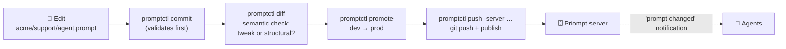
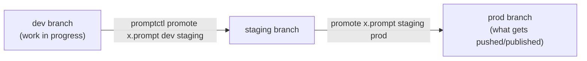

# promptctl

**The writing desk for your prompts.** `promptctl` is the authoring CLI for
[Priompt](https://github.com/) — it lets prompt writers work the way developers
work on code: prompts are plain files in a git repo, every change is validated
and committed, far-reaching edits are flagged by a semantic diff *before* they ship,
and one command publishes to the Priompt server that your AI agents read from.

## The 30-second version

You write prompts as ordinary text files. `promptctl` adds three things a plain
text editor can't give you:

1. **A safety gate** — a malformed prompt (a `{placeholder}` you forgot to
   declare, an empty template) cannot be committed. Ever.
2. **A meaning check** — before you ship an edit, a semantic diff tells you
   whether it's a harmless tweak or a **structural** change that rewires the
   prompt's meaning.
3. **An environments story** — dev → staging → prod are just git branches, and
   `promote` moves a prompt between them deliberately.



Under the hood, versioning/history/lineage are **plain git**, embedded via
go-git — no external git binary needed. A prompt's URI is simply its file path:
`acme/support/agent.prompt` → `priompt://acme/support/agent`. Slots are read
straight from the template's `{placeholders}` — nothing to declare by hand.

Because the first path segment is the **org** — the unit of access control on
the server — every prompt must live in at least one directory. A `.prompt` file
at the repo root has no org to belong to and is rejected at commit.

## Install

```sh
go install github.com/priompt/cli/cmd/promptctl@latest   # Go 1.25+
# or, from a clone: go build -o promptctl ./cmd/promptctl
```

## Commands

```sh
promptctl commit -m "msg"                     # validate every *.prompt, then commit changes
promptctl diff [ref]                           # semantic diff vs ref (default HEAD)
promptctl log acme/support/agent.prompt        # version lineage of one prompt
promptctl promote acme/x.prompt dev prod       # bring a prompt from branch dev onto prod
promptctl push [-server host:port]             # validate, git push, then publish to the server
promptctl pull                                 # sync with origin
promptctl publish -server host:port [paths…]   # publish to the server + notify subscribers
```

## A day in the life

```sh
# 1. write or edit a prompt — it's just a file
echo "You are a support agent for {org}. Be concise." > acme/support/agent.prompt

# 2. commit — validation runs on every *.prompt first;
#    one malformed prompt blocks the whole commit
promptctl commit -m "tighten support tone"

# 3. before shipping, see what the edit *means*, not just what it says
promptctl diff HEAD~1
# change @ new lines 1-1 (old 1-1): replace
#   Signal 2 (point delta): 0.470
#   Signal 3 up:   ±2=0.095 (boundary)
#   Signal 3 down: ±2=0.153 ±4=0.153 (flat)
#   => localized tweak                      ← the edit stayed local. See below.

# 4. ship it: git push + publish to the server in one step
promptctl push -server prompts.internal:8443
```

## Environments = branches

`promote` models dev → staging → prod as git branches: it copies a validated
prompt from one branch onto another and commits it — a deliberate, recorded
promotion instead of a copy-paste.



## Behavior notes

- **commit / push validate first** — a malformed prompt blocks the whole commit.
  "Malformed" includes the two placeholder typos that auto-derived slots cannot
  catch by themselves: `{{name}}` (doubled braces are an escaped literal brace
  to a formatter, so the slot would never be filled in) and `{name` (an unclosed
  brace is just literal text). Both used to commit silently and fail at runtime.
- **the verdict measures spread, not risk.** `localized tweak` means the edit's
  meaning shift stayed local — not that it is harmless. Turning "offer a refund
  when reasonable" into "never offer a refund" is a localized tweak and a policy
  reversal at the same time. Use it to decide what to look at first, not what to
  skip.
- **diff** compares each changed `*.prompt` between a ref and the working tree
  using the `PRIOMPT_EMBED_*` model. With no model configured it falls back to
  an offline lexical embedder (word overlap, not meaning) — good enough to
  catch big rewrites, but point it at a real embedding endpoint for real
  semantics.
- **push / pull** use go-git and do not read git's credential helper — set
  `PRIOMPT_GIT_TOKEN` for HTTPS remotes; SSH uses your ssh-agent.
- `promptctl push -server …` git-pushes **and** publishes each prompt, so
  subscribed agents are notified in the same step. Publishing is idempotent
  (unchanged content is a no-op), so only real changes fire a notification.
  Git stays the source of truth; the server is the live serving copy.
- `push` / `publish` accept `-tls` and `-ca-cert` for TLS servers.

## Configuration

| Variable | Purpose |
| --- | --- |
| `PRIOMPT_EMBED_URL` | OpenAI-compatible embeddings endpoint for the semantic diff (Ollama, TEI, llama.cpp…) |
| `PRIOMPT_EMBED_MODEL` | embedding model name |
| `PRIOMPT_EMBED_KEY` | API key for the embeddings endpoint |
| `PRIOMPT_GIT_TOKEN` | token for HTTPS git remotes (go-git skips git's credential helper) |

## Relation to the other repos

| Repo | Role |
| --- | --- |
| **priompt** | The server this CLI publishes to — full docs on versioning, auth, and the semantic diff live there |
| **proto** | Where the gRPC stubs, semantic diff engine (`github.com/priompt/proto/semdiff`), and validation rules (`github.com/priompt/proto/validate`) come from — imported, not copied; this repo carries no copies of anything |
| **python-sdk / js-sdk** | How agents *read* what you publish |
